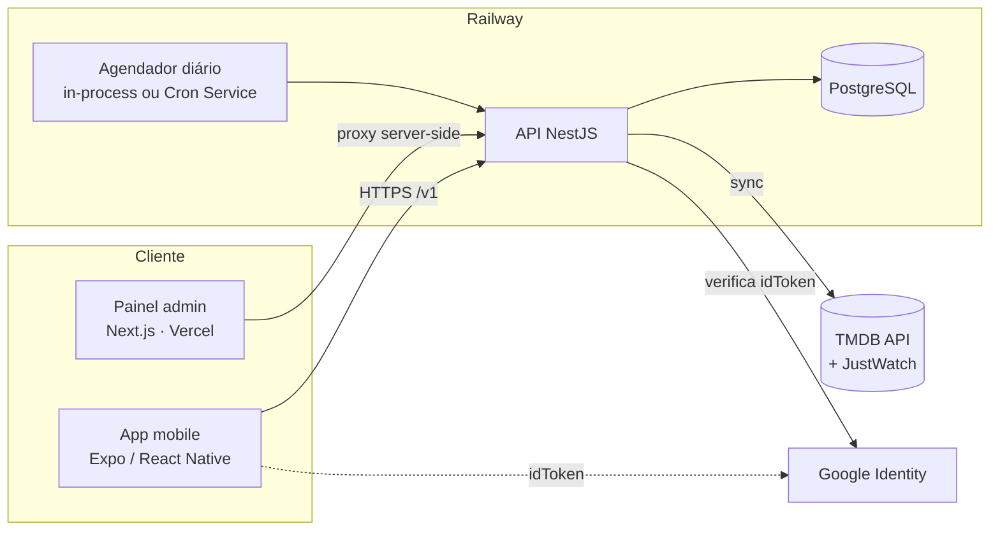

# 02 · Arquitetura

## Visão geral

- **Mobile** conversa só com a API. Anônimo usa apenas endpoints públicos (`/v1/deck`, `/v1/titles`, `/v1/providers`).
- **Admin** é um app Next.js cujo servidor guarda o JWT em cookie httpOnly e faz proxy para `/v1/admin/*` (o token nunca chega ao JS do navegador).
- **Sincronização** roda dentro da API (cron configurável) ou como processo avulso (`pnpm sync`) — mesma lógica.

## Monorepo

`apps/api`, `apps/admin`, `apps/mobile`, `packages/contracts` (tipos). Gerenciado por pnpm workspaces.

## Contextos da API (DDD)

| Contexto | Responsabilidade |
| --- | --- |
| `catalog` | Modelo de Título/Gênero/Plataforma/Disponibilidade; deck (consulta com cursor); detalhes; listas de gêneros/plataformas |
| `ingestion` | Porta `MetadataGateway` (TMDB), `CatalogWriter`, caso de uso `SyncCatalog`, agendador, CLI |
| `identity` | Usuário, verificação do idToken Google, emissão/validação de JWT, guards, exclusão de conta |
| `library` | Decisões (swipes), lista de quero-assistir, "já vi", importação do histórico anônimo |
| `backoffice` | Modelo de leitura/comandos do painel admin (stats, moderação, plataformas, sync manual, usuários) |

Camadas e regra de dependência: ver [CLAUDE.md](../CLAUDE.md#arquitetura-api--regras-que-não-devem-ser-quebradas). Princípios aplicados:

- **SOLID**: portas/adaptadores (DIP), casos de uso com responsabilidade única, extensão por novas implementações de porta (OCP) — ex.: outro provedor de metadados.
- **Clean Code**: funções pequenas e nomes de domínio; regras puras isoladas em `domain/` (`age-rating`, `anime`, `deck`).
- **CQS leve**: `backoffice` usa repositório de leitura próprio, sem passar por regras de escrita.

## Decisões transversais

- Configuração validada com **zod** na inicialização (falha rápido) — `config/app-config.ts`.
- **Rate limiting** global (120 req/min/IP) e mais restrito no login (20/min).
- **helmet**, CORS por allowlist (`CORS_ORIGINS`), validação de entrada (`class-validator`, `whitelist`).
- **Healthcheck** `/health` (verifica o banco) para Railway/Docker.
- **Swagger** em `/docs`.

ADRs em [adr/](adr/).
