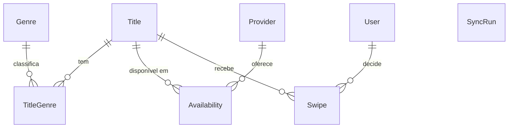

# 03 · Domínio e dados

Schema: [`apps/api/prisma/schema.prisma`](../apps/api/prisma/schema.prisma). PostgreSQL.

| Entidade | Notas |
| --- | --- |
| **Title** | Filme (`MOVIE`) ou série (`SERIES`), único por `(tmdbId, kind)`. `isAnime` calculado na ingestão. `certification`/`minAge` = classificação BR. `hidden`/`featured` = moderação. `popularity` ordena o deck. |
| **Genre** | Mesmo id do TMDB (animação = 16). |
| **Provider** | Plataforma (id TMDB/JustWatch). `enabled` controla ingestão e exibição. Alguns vêm habilitados por padrão (Netflix 8, Prime 119, Disney+ 337, Max 1899, Apple TV+ 350, Globoplay 307, Paramount+ 531, Crunchyroll 283). |
| **Availability** | `(titleId, region, type, providerId?, lastSeenAt)`. `type`: `CINEMA` (sem provider), `FLATRATE`, `RENT`, `BUY`. Para streaming é substituída por completo a cada sync do título; `CINEMA` expira por `lastSeenAt` (`pruneStaleCinema`). |
| **User** | Só existe para quem logou com Google (`googleSub` único). `role`: `USER`/`ADMIN`. |
| **Swipe** | PK `(userId, titleId)`. `decision` LIKE/DISLIKE; `watched` só faz sentido com LIKE. Cascata ao excluir usuário/título. |
| **SyncRun** | Histórico de sincronizações (status, stats JSON, erro). Serve também de **trava** contra execuções simultâneas. |

## Invariantes

- Um usuário tem no máximo uma decisão por título (upsert).
- `watched=true` implica `decision=LIKE` (mudar para DISLIKE zera `watched`).
- Título sem `Availability` não aparece no deck; sem decisões e sem disponibilidade por 30 dias, é removido (`pruneOrphanTitles`).
- Região única configurável (`TMDB_REGION`, padrão `BR`); o campo `region` já prepara multi-região.

## Classificação indicativa

`domain/age-rating.ts` normaliza os valores do TMDB para o BR: `L`→0, `10`, `12`, `14`, `16`, `18`. Valores de outros países ou desconhecidos viram `null` (a carta simplesmente não exibe selo).
